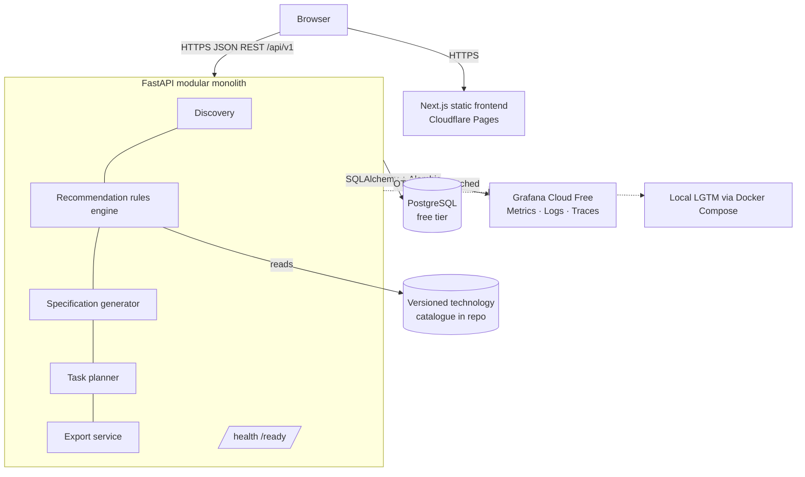

# System design (initial)

Status: draft v0.1 (2026-11-20). Hosting targets are proposals pending the deployment spike (ADR-0003).

## Logical architecture

## Deployment architecture (proposed)

| Component | Proposed host | Why |
|---|---|---|
| Frontend | Next.js `output: 'export'` static site on Cloudflare Pages | No server runtime needed; avoids Next.js-on-Workers adapter limits; unlimited static requests on free plan (to be verified). |
| API | FastAPI container on Render free web service (fallback: see assessment) | Runs standard CPython + SQLAlchemy + OTel without adaptation; sleeps when idle (documented). |
| Database | Supabase Free or Neon Free Postgres | Managed Postgres; pause/size limits documented. |
| Telemetry | OTel SDK in the API exporting OTLP/HTTP directly to Grafana Cloud | No extra collector service to host; collector only in the local profile. |
| CI/CD | GitHub Actions (public repo) | Free minutes for public repos. |

The browser calls the API directly (CORS restricted to the Pages origin). No secrets live in the frontend.
