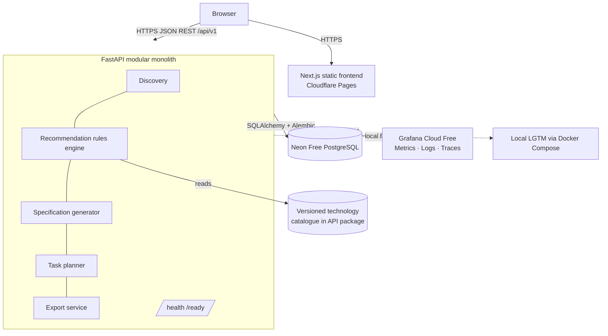

# BuildWise system design

Public MVP architecture. See [hosting ADR](../adr/0003-hosting-platform.md),
[telemetry ADR](../adr/0004-observability.md) and the [release workflow](../../.github/workflows/deploy-production.yml).

## Logical architecture

The backend derives versioned signals from discovery and requirements, with
explicit overrides in `recommendation_inputs`. Its pure scoring engine sums matching
catalogue rule weights and breaks ties by entry id. Generation performs no network
calls and stores no result timestamps; canonical signal values produce a SHA-256
fingerprint. Evidence retains field paths and short excerpts. AI text only creates
a note: only explicit `ai_layer=required` enables optional cost-dependent candidates.
The public catalogue endpoint serves the same startup-validated catalogue used by
the engine. Project endpoints reuse browser-token ownership and public read-only
sample access. The static client fetches these endpoints for the Architecture tab
and catalogue browser; owner overrides are saved with the existing project token.

The browser generates a random token once when creating a first project. The
API stores only its hash and checks it on each private project read or write.
The public seed is readable without a token and cannot be mutated through the
API. Alembic migrates PostgreSQL before the API starts. Deployment startup
reseeds only the sample's discovery, requirements, documents, tasks and plans.
The workbench layer assembles the browser's recent-project summary and exports
current documents and plans as one Markdown project pack.

## Deployment architecture

| Component | Host | Why |
|---|---|---|
| Frontend | Next.js static export on Cloudflare Pages | No server runtime, no Workers Functions; unlimited static requests on the free plan. |
| API | One FastAPI container on Render Free | Standard CPython + SQLAlchemy + OpenTelemetry; can sleep when idle. |
| Database | Neon Free PostgreSQL | Managed Postgres with compute resume; verify storage/compute quota. |
| Telemetry | OTel SDK in the API exporting OTLP/HTTP directly to Grafana Cloud | No extra collector service to host; collector only in the local profile. |
| CI/CD | GitHub Actions (public repo, standard runners) | PR and main CI; deploys the tested main commit to both providers. |

The browser calls the API directly; production CORS is restricted to the Pages
origin. No secrets live in the frontend. See the
[free-tier assessment](../hosting/free-tier-assessment.md) for limits and the
[operations runbook](../operations/observability.md) for telemetry and recovery.
